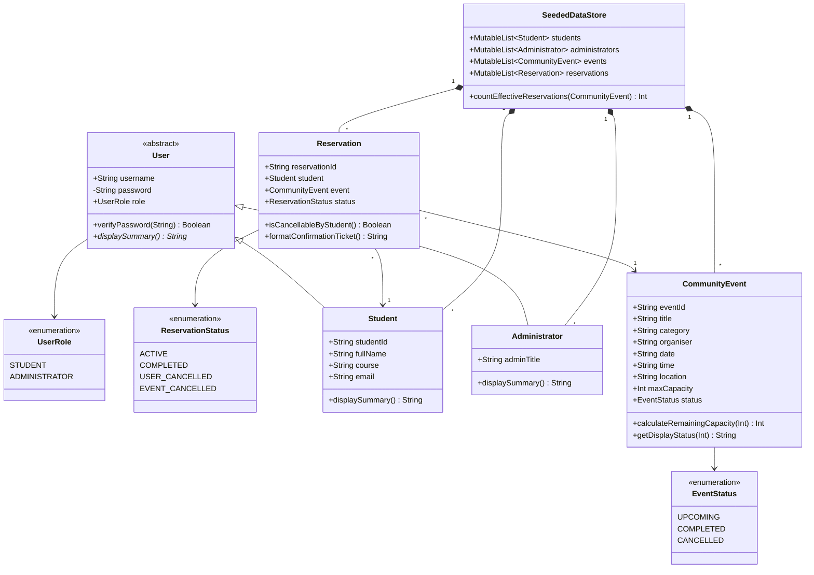

# QHO543 Object Oriented Design and Development
# AE1 Group Report: Campus Community Management System (Console Mode Version)

**Module Code:** QHO543  
**Module Leader:** Serif Salem  
**Assessment:** AE1 – Group Project (Console-Based Application)  
**Group Repository URL:** `https://github.com/solent-qho543-group/campus-community-management-ae1` (Local Git repository with full `main`, `memberA`, `memberB`, `memberC` branches included in project ZIP)  
**Group Members:**
- **Group Member A (Group Leader):** Student Event Functionality (Tasks 1–3)
- **Group Member B:** Community Event Management – Admin (Tasks 4–6)
- **Group Member C:** Registration, Authentication and Analytics (Tasks 7–9)

---

## 1. Stage I – Requirements Analysis and Initial Class Design

During Stage I, our three-member group collaboratively analysed the AE1 specification and the compulsory dataset defined in *QHO543 – Initial Seeded Data*. Our objective was to design a cohesive object-oriented domain model capable of supporting all nine tasks without relying on an external database, while enforcing strict encapsulation, inheritance, polymorphism, and single responsibility across classes.

### 1.1 Initial List of Proposed Classes

1. **`UserRole` (`enum class`)**: Represents the two security principals in the university community environment (`STUDENT` and `ADMINISTRATOR`).
2. **`EventStatus` (`enum class`)**: Models the lifecycle states of a community event (`UPCOMING`, `COMPLETED`, `CANCELLED`).
3. **`ReservationStatus` (`enum class`)**: Models the four distinct reservation states required by Tasks 3 and 6 (`ACTIVE`, `COMPLETED`, `USER_CANCELLED`, `EVENT_CANCELLED`).
4. **`User` (`abstract class`)**: Serves as the abstract superclass for all system users. It encapsulates `username`, `password` (kept `private` with a verification method `verifyPassword()`), and `role`, and declares an abstract `displaySummary()` method overridden polymorphically by subclasses.
5. **`Student` (`class`)**: Inherits from `User` (`UserRole.STUDENT`) and encapsulates `studentId`, `fullName`, `course`, and `email`.
6. **`Administrator` (`class`)**: Inherits from `User` (`UserRole.ADMINISTRATOR`) and represents university staff authorised to manage community events and inspect analytics.
7. **`CommunityEvent` (`class`)**: Encapsulates event attributes (`eventId`, `title`, `category`, `organiser`, `date`, `time`, `location`, `maxCapacity`, `status`) alongside domain behaviour to calculate remaining capacity, capacity utilisation percentage, and effective display status (`Upcoming`, `Full`, `Completed`, or `Cancelled`).
8. **`Reservation` (`class`)**: Models the associative relationship between a `Student` and a `CommunityEvent` (`reservationId`, `student`, `event`, `status`) and formats the mandatory Task 2 confirmation ticket.
9. **`SeededDataStore` (`class`)**: Acts as the in-memory data repository initialised with the six predefined students (`S001`–`S006`), one administrator (`admin`), six events (`E001`–`E006`), and fourteen reservations (`R001`–`R014`).
10. **Service Classes (`StudentEventService`, `AdminEventService`, `AuthAndAnalyticsService`)**: Encapsulate the business rules for Member A (Tasks 1–3), Member B (Tasks 4–6), and Member C (Tasks 7–9), cleanly separating domain logic from console `Scanner` I/O.

### 1.2 Initial Class Diagram



---

## 2. Stage II – Individual Branch Development Summary

Following repository initialisation on `main`, each member created their dedicated feature branch from the Stage I baseline:
- **Branch `memberA`**: Implemented `StudentEventService` and `MemberAConsoleMenu` along with an independent `Main.kt` entry point providing a three-option menu for Tasks 1–3. Member A implemented multi-criteria searching (by title, category, organiser, and date), capacity-aware status reporting (`Full` when `remainingCapacity == 0` on an `Upcoming` event such as `E002`), reservation validation, formatted confirmation printing, and student cancellation (`User Cancelled`).
- **Branch `memberB`**: Implemented `AdminEventService` and `MemberBConsoleMenu` with an independent `Main.kt` entry point for Tasks 4–6. Member B implemented status-filtered event views (`All`, `Upcoming`, `Completed`, `Cancelled`), validated event creation (`E007+`) and modification (preventing capacity reductions below current active reservations and disallowing cancellation inside Task 5), and event cancellation (Task 6) that cascades `Event Cancelled` status to all active reservations for that event.
- **Branch `memberC`**: Implemented `AuthAndAnalyticsService` and `MemberCConsoleMenu` with an independent `Main.kt` entry point for Tasks 7–9. Member C implemented student registration with duplicate checking across Student IDs, emails, and usernames, polymorphic login authentication, and dynamic calculation of completed, upcoming, and cancelled event analytics.

---

## 3. Stage III – Group Integration Process

### 3.1 Order in Which Member Branches Were Merged

Once all three members verified that their individual branches compiled and ran independently against `SeededDataStore`, the group agreed on a structured three-step merge order into `main`:
1. **Step 1 (`memberA` -> `main`)**: Merged first because Member A's student event and reservation workflows established the core `ServiceResult` pattern and console table formatting conventions. Because `main` had not diverged since `memberA` branched off, Git performed a clean merge (`Merge made by the 'ort' strategy`) with no conflicts.
2. **Step 2 (`memberB` -> `main`)**: Merged second to unite the student-facing operations (Tasks 1–3) with the administrative event management operations (Tasks 4–6), forming a complete two-member functional baseline.
3. **Step 3 (`memberC` -> `main`)**: Merged last because Member C's authentication and role-based access control (Task 8) wraps around both Member A's student menu and Member B's administrator menu, while Task 9 (Analytics) plugs directly into the authenticated Administrator dashboard.

### 3.2 Merge Conflicts Encountered and How They Were Resolved

Because each member adhered strictly to the package structure agreed in Stage I (`service/` and `ui/` files named by member responsibility), the service and menu classes (`StudentEventService.kt`, `AdminEventService.kt`, `AuthAndAnalyticsService.kt`, `MemberAConsoleMenu.kt`, `MemberBConsoleMenu.kt`, `MemberCConsoleMenu.kt`) merged without file-level collisions. However, **two deliberate content merge conflicts occurred in `src/main/kotlin/uk/ac/solent/campus/ae1/Main.kt`**:

1. **Conflict 1 (`memberB` into `main`)**:
   - *Cause*: In Stage II, every member was required to modify `Main.kt` so that their branch could run and demonstrate their three assigned tasks standalone. Consequently, `HEAD` (`main` after merging `memberA`) instantiated `MemberAConsoleMenu`, whereas `memberB` instantiated `MemberBConsoleMenu`.
   - *Resolution*: The group reviewed both conflict markers (`<<<<<<< HEAD` and `>>>>>>> memberB`) and replaced the standalone entry points with a unified dispatcher that shared a single `SeededDataStore` instance across both `MemberAConsoleMenu` and `MemberBConsoleMenu`.
2. **Conflict 2 (`memberC` into `main`)**:
   - *Cause*: Branch `memberC` had its own standalone `Main.kt` invoking `MemberCConsoleMenu.runStandaloneMenu()`, which conflicted with the combined Member A + B `Main.kt` on `main`.
   - *Resolution*: We introduced `IntegratedConsoleApp.kt` to coordinate all three services (`StudentEventService`, `AdminEventService`, and `AuthAndAnalyticsService`) over a single shared `SeededDataStore` and updated `Main.kt` to launch `IntegratedConsoleApp().run()`.

### 3.3 Structural Refinements Made During Integration

To ensure seamless interoperability across all nine tasks in Stage III, two key refinements were made during integration:
1. **Context-Aware Student Identity in `MemberAConsoleMenu`**: During Stage II, Member A's menu prompted the user to type a predefined Student ID (`S001`–`S006`) for Tasks 2 and 3 so it had no dependency on Member C. During Stage III integration, `MemberAConsoleMenu.runMenu(loggedInStudent: Student? = null)` was parameterised with an optional authenticated `Student` reference. When launched via Member C's login flow (3-member mode), Tasks 2 and 3 automatically bind to `loggedInStudent.studentId` so a logged-in student cannot impersonate another student. When launched in standalone or 2-member mode (`loggedInStudent == null`), it continues to prompt for a predefined Student ID.
2. **Unified Administrator Dashboard (`IntegratedConsoleApp.runAuthenticatedAdminMenu`)**: For an authenticated Administrator (`admin` / `Admin123`), we combined Member B's handlers (Task 4: View Events by Filter, Task 5: Add/Modify Events, Task 6: Cancel Upcoming Event) with Member C's analytics handler (Task 9: View Community Event Analytics) inside a single role-protected menu. Because all three services reference the same `SeededDataStore` instance, cancelling an event in Task 6 or making a reservation in Task 2 immediately updates remaining capacities in Task 1/Task 4 and recalculates analytics in Task 9.

---

## 4. Appendix – Git Branch Structure and Commit History Evidence

Below is the actual Git branch graph and commit history from our repository (`git log --all --graph --oneline --decorate`):

```text
*   e2669c0 (HEAD -> main) Stage III Integration (Step 3): Merge memberC branch (Tasks 7-9), implement IntegratedConsoleApp, and add JUnit test suite
|\  
| * 782a949 (memberC) Member C (Tasks 7-9): Add MemberCConsoleMenu and standalone main() entry point for Member C demonstration
| * 44edb29 Member C (Tasks 7-9): Implement AuthAndAnalyticsService for student registration, role auth, and event analytics
* |   1fe786b Stage III Integration (Step 2): Merge memberB branch (Tasks 4-6) and resolve Main.kt conflict
|\ \  
| * | 791cdec (memberB) Member B (Tasks 4-6): Add MemberBConsoleMenu and standalone main() entry point for Member B demonstration
| * | 24f51f4 Member B (Tasks 4-6): Implement AdminEventService for viewing by status, adding/modifying, and cancelling events
* | |   a07020c Stage III Integration (Step 1): Merge memberA branch (Tasks 1-3)
|\ \ \  
| |/ /  
|/| |   
| * | 29eb6c8 (memberA) Member A (Tasks 1-3): Add MemberAConsoleMenu and standalone main() entry point for Member A demonstration
| * | 53b5ab9 Member A (Tasks 1-3): Implement StudentEventService for viewing/searching, reserving, and cancelling events
|/ /  
* | 0a82917 Stage I: Implement compulsory QHO543 initial seeded dataset in SeededDataStore
* | 4ff2857 Stage I: Implement initial domain entity classes (User, Student, Administrator, CommunityEvent, Reservation)
|/  
* 275eb05 Stage I: Add project build setup, initial class list, and UML class diagram
```
