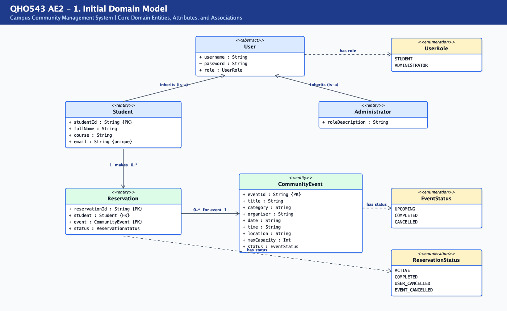
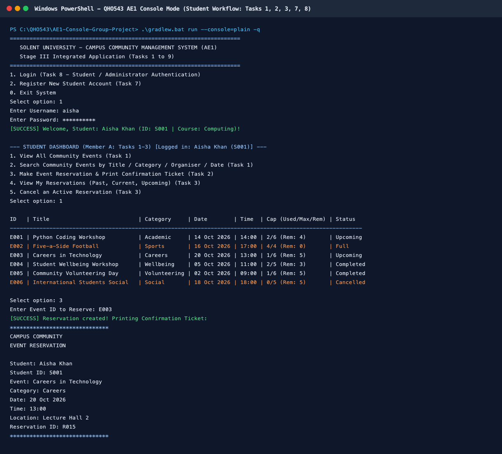
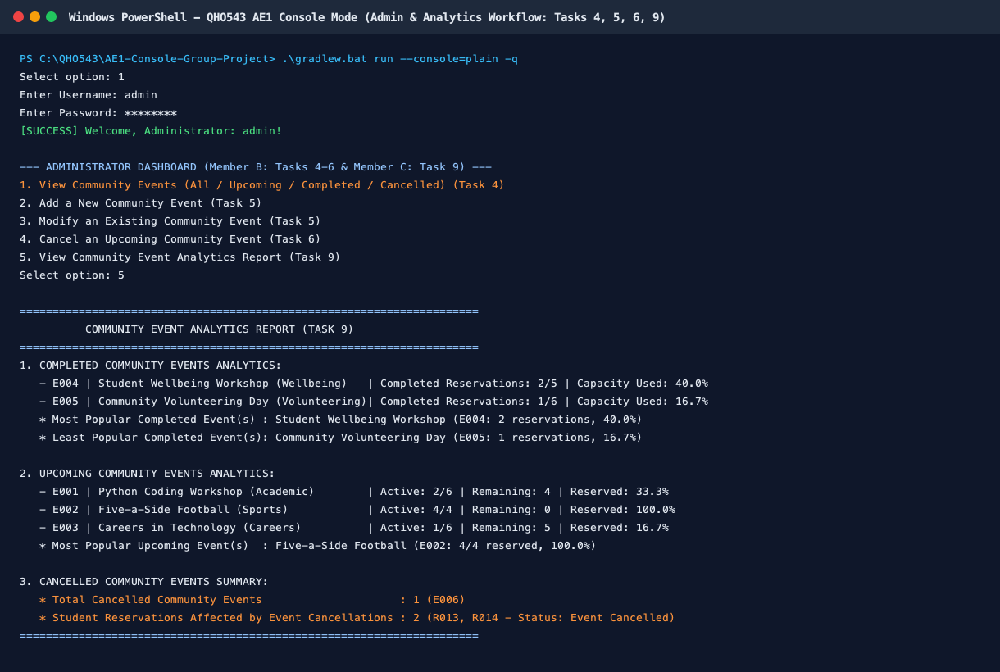
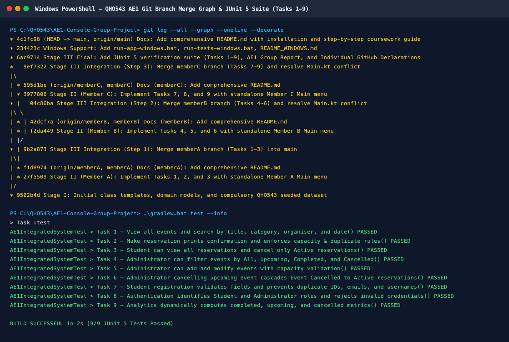

# QHO543 AE1 – Campus Community Management System (Console Mode Group Project)
### *Complete Instructor Sheet, Step-by-Step Student Worksheet, Solutions, Grading Matrix & Console Screenshots*

A complete **Kotlin Object-Oriented Console Application** and **JUnit 5 Verification Suite** for **Solent University – QHO543: Object Oriented Design and Development (Assessment Element 1 – Group Project)**.

This repository demonstrates the full **3-Stage Git Collaborative Workflow** (`main`, `memberA`, `memberB`, `memberC`), implementing **Tasks 1–9** against the compulsory **QHO543 Initial Seeded Data** dataset (`S001–S006`, `admin`, `E001–E006`, `R001–R014`).

---

## Table of Contents

1. [Prerequisites & Installation (Windows 10/11 & macOS/Linux)](#1-prerequisites--installation-windows-1011--macoslinux)
2. [How to Clone, Open & Run the Project (Windows & macOS)](#2-how-to-clone-open--run-the-project-windows--macos)
3. [Compulsory Seeded Dataset & Instructor Verification Matrix](#3-compulsory-seeded-dataset--instructor-verification-matrix)
4. [Step-by-Step Instructor & Student Worksheet (Stages I, II, and III)](#4-step-by-step-instructor--student-worksheet-stages-i-ii-and-iii)
   - [Stage I: Group Analysis, UML Class Design & Baseline Template (`main`)](#stage-i-group-analysis-uml-class-design--baseline-template-main-branch--10-weighting)
   - [Stage II (Member A): Student Event Functionality (`memberA` – Tasks 1–3)](#stage-ii-member-a-student-event-functionality-membera-branch--tasks-13)
   - [Stage II (Member B): Admin Event Management (`memberB` – Tasks 4–6)](#stage-ii-member-b-admin-event-management-memberb-branch--tasks-46)
   - [Stage II (Member C): Registration, Auth & Analytics (`memberC` – Tasks 7–9)](#stage-ii-member-c-registration-authentication--analytics-memberc-branch--tasks-79)
   - [Stage III: Branch Integration, Merge Conflict Resolution & JUnit 5 Verification (`main`)](#stage-iii-branch-integration-merge-conflict-resolution--junit-5-verification-main-branch--40-weighting)
5. [Application Execution & JUnit 5 Screenshots](#5-application-execution--junit-5-screenshots)
6. [Instructor Grading Rubric & Viva Voce Questions](#6-instructor-grading-rubric--viva-voce-questions)
7. [Project Directory Structure](#7-project-directory-structure)

---

## 1. Prerequisites & Installation (Windows 10/11 & macOS/Linux)

### Required Tools
1. **Java Development Kit (JDK) 17 or 21+ (64-bit)**
2. **Git** (to inspect and switch between `main`, `memberA`, `memberB`, and `memberC`)
3. **IntelliJ IDEA (Community or Ultimate Edition)** *(Optional — you can also run via the bundled `run-app-windows.bat`, `run-tests-windows.bat`, or `gradlew` scripts).*

### Installing on Windows 10 / Windows 11
Open **PowerShell** and run:
```powershell
java -version
git --version

# If missing, install Eclipse Temurin JDK 21 and Git via winget:
winget install EclipseAdoptium.Temurin.21.JDK
winget install Git.Git
```

### Installing on macOS / Linux
```bash
# macOS (via Homebrew):
brew install --cask temurin@21
brew install git

# Ubuntu / Debian Linux:
sudo apt update && sudo apt install -y openjdk-21-jdk git
```

---

## 2. How to Clone, Open & Run the Project (Windows & macOS)

### Step 1: Clone the Repository (or Extract the ZIP on Windows)
```bash
git clone https://github.com/KashifJavaid/QHO543-AE1-Campus-Community-Console.git
cd QHO543-AE1-Campus-Community-Console
```
> **Important for Windows ZIP Users:** Do **not** double-click `run-app-windows.bat` directly inside Windows Explorer's compressed `.zip` preview window. Always right-click `AE1_Group_Integrated_Project.zip` -> **Extract All...** first.

### Step 2: Run the Console App & Automated Tests

#### Option A: One-Click Windows Batch Scripts
- Double-click **`run-app-windows.bat`** -> Starts the interactive Console application in Command Prompt.
- Double-click **`run-tests-windows.bat`** -> Runs all 9 JUnit 5 verification tests (`Tasks 1–9`).

#### Option B: Windows PowerShell / Command Prompt (`cmd.exe`)
```powershell
# In Windows PowerShell (note the .\ prefix):
.\gradlew.bat test --info
.\gradlew.bat run --console=plain -q

# Switch branches to inspect and grade each member's standalone Stage II work:
git checkout memberA
.\gradlew.bat run --console=plain -q

git checkout memberB
.\gradlew.bat run --console=plain -q

git checkout memberC
.\gradlew.bat run --console=plain -q

git checkout main
```

#### Option C: macOS / Linux Terminal
```bash
./gradlew test --info
./gradlew run --console=plain -q
```

---

## 3. Compulsory Seeded Dataset & Instructor Verification Matrix

Initialized automatically via [`SeededDataStore.kt`](./src/main/kotlin/uk/ac/solent/campus/ae1/data/SeededDataStore.kt):

### 3.1 Predefined Students (`S001`–`S006`) & Administrator (`admin`)

| ID / Role | Full Name | Course | Email | Username | Password | Initial Reservations |
| :--- | :--- | :--- | :--- | :--- | :--- | :--- |
| **`S001`** (Student) | Aisha Khan | Computing | `aisha.khan@student.ac.uk` | `aisha` | `Student123` | `R001` (`E001` Active), `R004` (`E002` Active), `R009` (`E004` Completed) |
| **`S002`** (Student) | Daniel Green | Business Management | `daniel.green@student.ac.uk` | `daniel` | `Student123` | `R002` (`E001` Active), `R005` (`E002` Active), `R013` (`E006` Event Cancelled) |
| **`S003`** (Student) | Maya Patel | Cyber Security | `maya.patel@student.ac.uk` | `maya` | `Student123` | `R003` (`E001` User Cancelled), `R010` (`E004` Completed) |
| **`S004`** (Student) | Omar Hassan | Software Engineering | `omar.hassan@student.ac.uk` | `omar` | `Student123` | `R006` (`E002` Active), `R011` (`E005` Completed) |
| **`S005`** (Student) | Emily Carter | Psychology | `emily.carter@student.ac.uk` | `emily` | `Student123` | `R007` (`E002` Active), `R012` (`E005` User Cancelled) |
| **`S006`** (Student) | Lucas Martin | Digital Marketing | `lucas.martin@student.ac.uk` | `lucas` | `Student123` | `R008` (`E003` Active), `R014` (`E006` Event Cancelled) |
| **`Administrator`** | — | — | — | `admin` | `Admin123` | Full Administrative & Analytics Access |

### 3.2 Predefined Community Events (`E001`–`E006`) & Calculated Baseline Metrics

| Event ID | Event Title | Category | Organiser | Date & Time | Location | Max Cap | Seeded Reservations | Effective Count | Remaining Cap | Lifecycle Status | Display Status | Capacity % |
| :--- | :--- | :--- | :--- | :--- | :--- | :---: | :--- | :---: | :---: | :--- | :--- | :---: |
| **`E001`** | Python Coding Workshop | Academic | Helen Moore | `14 Oct 2026` `14:00` | Computing Lab B12 | `6` | `R001` (Active), `R002` (Active), `R003` (User Cancelled) | **2** | **4** | `Upcoming` | **Upcoming** | **33.3%** |
| **`E002`** | Five-a-Side Football | Sports | Alex Turner | `16 Oct 2026` `17:00` | Sports Hall | `4` | `R004`, `R005`, `R006`, `R007` (All 4 Active) | **4** | **0** | `Upcoming` | **Full** | **100.0%** |
| **`E003`** | Careers in Technology | Careers | Rachel Adams | `20 Oct 2026` `13:00` | Lecture Hall 2 | `6` | `R008` (Active) | **1** | **5** | `Upcoming` | **Upcoming** | **16.7%** |
| **`E004`** | Student Wellbeing Workshop | Wellbeing | Sarah Lewis | `05 Oct 2026` `11:00` | Room C05 | `5` | `R009` (Completed), `R010` (Completed) | **2** | **3** | `Completed` | **Completed** | **40.0%** |
| **`E005`** | Community Volunteering Day | Volunteering | James Wilson | `02 Oct 2026` `09:00` | Community Hub | `6` | `R011` (Completed), `R012` (User Cancelled) | **1** | **5** | `Completed` | **Completed** | **16.7%** |
| **`E006`** | International Students Social | Social | Maria Costa | `18 Oct 2026` `18:00` | Student Union | `5` | `R013` (Event Cancelled), `R014` (Event Cancelled) | **0** | **5** | `Cancelled` | **Cancelled** | **0.0%** |

---

## 4. Step-by-Step Instructor & Student Worksheet (Stages I, II, and III)

### Stage I: Group Analysis, UML Class Design & Baseline Template (`main` Branch – 10% Weighting)



- **Step 1.1:** Create domain enumerations in [`Enums.kt`](./src/main/kotlin/uk/ac/solent/campus/ae1/model/Enums.kt) (`UserRole`, `EventStatus`, `ReservationStatus`, `EventSearchField`, `AdminEventFilter`).
- **Step 1.2:** Create polymorphic user hierarchy in [`User.kt`](./src/main/kotlin/uk/ac/solent/campus/ae1/model/User.kt) (`User`, `Student`, `Administrator`).
- **Step 1.3:** Create [`CommunityEvent.kt`](./src/main/kotlin/uk/ac/solent/campus/ae1/model/CommunityEvent.kt) and [`Reservation.kt`](./src/main/kotlin/uk/ac/solent/campus/ae1/model/Reservation.kt) (with `formatConfirmationTicket()`).
- **Step 1.4:** Populate compulsory seeded dataset in [`SeededDataStore.kt`](./src/main/kotlin/uk/ac/solent/campus/ae1/data/SeededDataStore.kt) and commit to `main`.

---

### Stage II (Member A): Student Event Functionality (`memberA` Branch – Tasks 1–3)

- **Branch:** `git checkout -b memberA main`
- **Service Implementation:** [`StudentEventService.kt`](./src/main/kotlin/uk/ac/solent/campus/ae1/service/StudentEventService.kt)
  - **Task 1 (`viewAllEvents`, `searchEvents`):** Search by `TITLE`, `CATEGORY`, `ORGANISER`, or `DATE`. Display `"Full"` when `status == UPCOMING` and `remainingCapacity == 0` (`E002`).
  - **Task 2 (`makeReservation`):** Validate student ID, `UPCOMING` status, `remainingCapacity > 0`, and no duplicate `ACTIVE` reservation for the same student and event. Output formatted confirmation ticket (`R015`).
  - **Task 3 (`getStudentReservations`, `cancelStudentReservation`):** Cancel only `ACTIVE` reservations -> update status to `USER_CANCELLED` and free capacity while keeping the record in reservation history.
- **Standalone UI:** [`MemberAConsoleMenu.kt`](./src/main/kotlin/uk/ac/solent/campus/ae1/ui/MemberAConsoleMenu.kt)

---

### Stage II (Member B): Admin Event Management (`memberB` Branch – Tasks 4–6)

- **Branch:** `git checkout -b memberB main`
- **Service Implementation:** [`AdminEventService.kt`](./src/main/kotlin/uk/ac/solent/campus/ae1/service/AdminEventService.kt)
  - **Task 4 (`getEventsByFilter`):** Filter by `ALL` (6), `UPCOMING` (3), `COMPLETED` (2), `CANCELLED` (1).
  - **Task 5 (`addCommunityEvent`, `modifyCommunityEvent`):** Validate non-blank fields and `maxCapacity > 0`. Reject reducing `maxCapacity` below current active/completed reservations (`E002` cannot be reduced below `4`).
  - **Task 6 (`cancelCommunityEvent`):** Transition an `UPCOMING` event to `CANCELLED` and update all `ACTIVE` reservations for that event to `EVENT_CANCELLED` (leaving `USER_CANCELLED` reservations like `R003` unchanged).
- **Standalone UI:** [`MemberBConsoleMenu.kt`](./src/main/kotlin/uk/ac/solent/campus/ae1/ui/MemberBConsoleMenu.kt)

---

### Stage II (Member C): Registration, Authentication & Analytics (`memberC` Branch – Tasks 7–9)

- **Branch:** `git checkout -b memberC main`
- **Service Implementation:** [`AuthAndAnalyticsService.kt`](./src/main/kotlin/uk/ac/solent/campus/ae1/service/AuthAndAnalyticsService.kt)
  - **Task 7 (`registerStudent`):** Validate non-empty inputs, valid email format, and prevent duplicate `studentId`, `email`, or `username`.
  - **Task 8 (`authenticateUser`):** Authenticate against `students` and `administrators`, returning the polymorphic `User` instance.
  - **Task 9 (`generateAnalytics`):** Compute Completed event metrics (`E004` most popular 40.0%, `E005` least popular 16.7%), Upcoming event metrics (`E002` most popular 100.0%), and Cancelled event summary (`1` event `E006`, `2` affected reservations `R013`, `R014`).
- **Standalone UI:** [`MemberCConsoleMenu.kt`](./src/main/kotlin/uk/ac/solent/campus/ae1/ui/MemberCConsoleMenu.kt)

---

### Stage III: Branch Integration, Merge Conflict Resolution & JUnit 5 Verification (`main` Branch – 40% Weighting)

- Merge `memberA`, `memberB`, and `memberC` into `main` using `git merge --no-ff`.
- Resolve `Main.kt` conflicts by delegating to [`IntegratedConsoleApp.kt`](./src/main/kotlin/uk/ac/solent/campus/ae1/ui/IntegratedConsoleApp.kt).
- Verify all 9 tasks via [`AE1IntegratedSystemTest.kt`](./src/test/kotlin/uk/ac/solent/campus/ae1/AE1IntegratedSystemTest.kt).

---

## 5. Application Execution & JUnit 5 Screenshots

### 5.1 Student Console Workflow (`Tasks 1, 2, 3, 7, 8`)


### 5.2 Administrator & Analytics Console Workflow (`Tasks 4, 5, 6, 9`)


### 5.3 Git Branch Merge Graph & JUnit 5 Verification Suite (`9/9 Tests Passed`)


---

## 6. Instructor Grading Rubric & Viva Voce Questions

| Stage | Weight | Assessment Focus |
| :--- | :---: | :--- |
| **Stage I** | **10%** | Initial UML Class Diagram, shared domain model templates, and `SeededDataStore` committed to `main`. |
| **Stage II** | **50%** | Individual branch development (`memberA`, `memberB`, `memberC`), clean commit logs, and standalone `Main.kt` execution for assigned 3 tasks. |
| **Stage III** | **40%** | Branch integration into `main`, merge conflict resolution, unified console menu, JUnit 5 verification (`AE1IntegratedSystemTest.kt`), and [`AE1_Group_Report.md`](./AE1_Group_Report.md). |

---

## 7. Project Directory Structure

```text
AE1-Console-Group-Project/
├── README.md                                 # Complete Instructor & Student Guide with Screenshots
├── README_WINDOWS.md                         # Dedicated Windows 10/11 quick-start instructions
├── AE1_Group_Report.md                       # Complete AE1 Group Report (Stages I, II, and III)
├── AE1_Individual_GitHub_Declarations.md     # Individual member GitHub URL & commit declaration templates
├── build.gradle.kts                          # Kotlin JVM + JUnit 5 build configuration
├── gradlew / gradlew.bat                     # Cross-platform Gradle Wrapper scripts
├── run-app-windows.bat                       # Double-click Windows launcher for the Console app
├── run-tests-windows.bat                     # Double-click Windows launcher for JUnit 5 tests
├── diagrams/
│   ├── AE1_Class_Diagram.png                 # UML Class Diagram (PNG)
│   └── AE1_Initial_Class_Diagram.md          # UML Class Diagram documentation
├── screenshots/
│   ├── 1_ae1_console_student_workflow.png
│   ├── 2_ae1_console_admin_and_analytics.png
│   └── 3_ae1_git_graph_and_junit_tests.png
└── src/
    ├── main/kotlin/uk/ac/solent/campus/ae1/
    │   ├── Main.kt                           # Stage III Entry Point
    │   ├── data/SeededDataStore.kt           # Compulsory QHO543 seeded dataset
    │   ├── model/                            # Enums.kt, User.kt, CommunityEvent.kt, Reservation.kt
    │   ├── service/                          # StudentEventService.kt, AdminEventService.kt, AuthAndAnalyticsService.kt
    │   └── ui/                               # IntegratedConsoleApp.kt, MemberAConsoleMenu.kt, MemberBConsoleMenu.kt, MemberCConsoleMenu.kt
    └── test/kotlin/uk/ac/solent/campus/ae1/
        └── AE1IntegratedSystemTest.kt        # Automated JUnit 5 test suite covering Tasks 1-9
```
