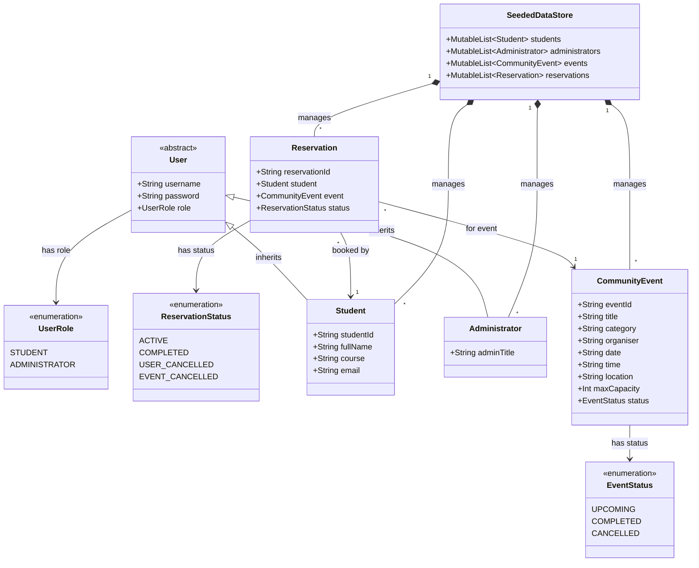

# QHO543 AE1 – Stage I: Initial Class List and Class Diagram

## 1. Proposed Classes List (Stage I Group Analysis)

| Class / Enum Name | Stereotype / Type | Description & Responsibility |
|---|---|---|
| `UserRole` | `enum class` | Represents system roles (`STUDENT`, `ADMINISTRATOR`) for role-based access control. |
| `EventStatus` | `enum class` | Represents lifecycle states of a community event (`UPCOMING`, `COMPLETED`, `CANCELLED`). |
| `ReservationStatus` | `enum class` | Represents lifecycle states of a student reservation (`ACTIVE`, `COMPLETED`, `USER_CANCELLED`, `EVENT_CANCELLED`). |
| `User` | `abstract class` | Base entity encapsulating common authentication credentials (`username`, `password`, `role`) shared by students and administrators. |
| `Student` | `class` | Subclass of `User` representing a university student (`studentId`, `fullName`, `course`, `email`, `username`, `password`). |
| `Administrator` | `class` | Subclass of `User` representing an administrative staff member (`username`, `password`). |
| `CommunityEvent` | `class` | Represents a scheduled university community event (`eventId`, `title`, `category`, `organiser`, `date`, `time`, `location`, `maxCapacity`, `status`). |
| `Reservation` | `class` | Association entity linking a `Student` to a `CommunityEvent` (`reservationId`, `student`, `event`, `status`). |
| `SeededDataStore` | `class` | In-memory repository holding the compulsory predefined students, administrator, community events, and reservations from `QHO543 – Initial Seeded Data`. |
| `StudentEventService` | `class` | Encapsulates Member A student tasks (Task 1: View & Search Events, Task 2: Make Reservation & Print Confirmation, Task 3: View & Cancel Active Reservations). |
| `AdminEventService` | `class` | Encapsulates Member B administrator tasks (Task 4: View Events by Status, Task 5: Add & Modify Events, Task 6: Cancel Upcoming Event & Update Reservations). |
| `AuthAndAnalyticsService` | `class` | Encapsulates Member C tasks (Task 7: Student Registration, Task 8: Authentication & Role Management, Task 9: Community Event Analytics). |

---

## 2. Initial Class Diagram (Stage I – Attributes and Relationships)

